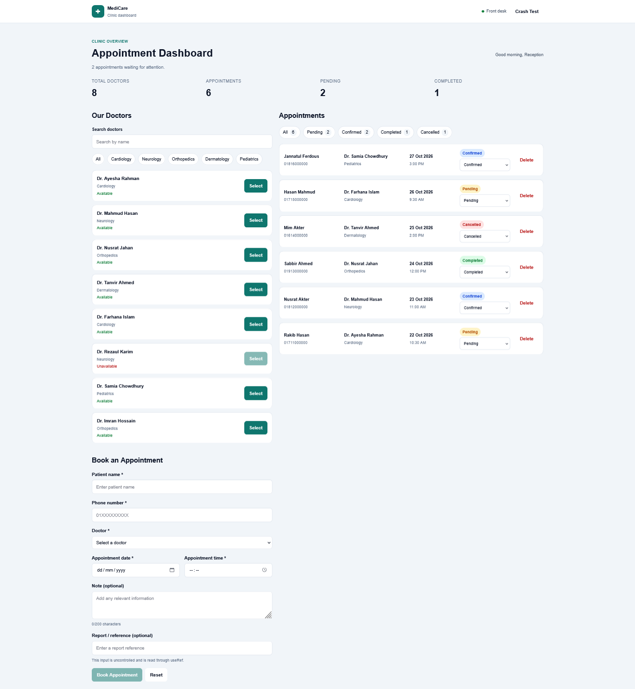

# MediCare Clinic — Appointment Dashboard UI

A responsive clinic appointment dashboard built with React and Vite. The app uses local JavaScript seed data and React state; it does not require a backend or API.

## Screenshot



Features

- Summary cards for total doctors, total appointments, pending appointments, and completed appointments.
- Doctor search and department filters.
- Doctor selection connected to the appointment form.
- Appointment form validation and success feedback.
- Appointment status updates and deletion with confirmation.
- Appointment status filters and counts.
- Reusable UI components and render props.
- Error Boundary, fallback UI, and global error logging.
- Responsive desktop, tablet, and mobile layouts.

## Technologies

- React
- Vite
- JavaScript
- CSS
- React hooks: `useState`, `useEffect`, and `useRef`

## Getting Started

### Prerequisites

Install Node.js and npm.

### Installation

```bash
npm install
npm run dev
```

Open the local URL displayed in the terminal.

### Production build

```bash
npm run build
npm run preview
```

## Project Structure

```text
src/
├── components/
│   ├── appointments/
│   ├── doctors/
│   ├── error/
│   ├── layout/
│   ├── stats/
│   └── ui/
├── data/
├── utils/
├── App.jsx
├── index.css
└── main.jsx
screenshots/
└── dashboard.png
```

## React Requirements Mapping

Update the file names and line numbers below after checking your final source code.

| Requirement                               | Implementation                                                                                 |
| ----------------------------------------- | ---------------------------------------------------------------------------------------------- |
| REQ-1: `.map()` and stable keys         | `src/components/doctors/DoctorList.jsx`, `src/components/appointments/AppointmentList.jsx` |
| REQ-2: Conditional rendering              | `src/components/`, `src/components/layout/Header.jsx`                                      |
| REQ-3: Lifting state up                   | `src/App.jsx`                                                                                |
| REQ-4: Props and callbacks                | `src/App.jsx`, doctor and appointment components                                             |
| REQ-5: `children` composition           | `src/components/ui/Card.jsx` and panel components                                            |
| REQ-6: Render props                       | `src/components/ui/FilterableList.jsx`                                                       |
| REQ-7: Controlled inputs                  | `src/components/appointments/AppointmentForm.jsx`                                            |
| REQ-8: Uncontrolled input with `useRef` | `src/components/appointments/AppointmentForm.jsx`                                            |
| REQ-9: Prop drilling solution             | `src/components/doctors/DoctorPanel.jsx`, `DoctorList.jsx`, and this README                |
| REQ-10: Click and submit handlers         | Doctor, appointment, and form components                                                       |
| REQ-11: Error Boundary and fallback       | `src/components/error/ErrorBoundary.jsx`, `FallbackUI.jsx`                                 |
| REQ-12: Global error handlers and logger  | `src/main.jsx`, `src/utils/logger.js`                                                      |

## Prop Drilling

Prop drilling happens when a value or callback is passed through intermediate components that do not need to use it themselves. In this project, the original approach passed doctor-related data through the doctor panel and list hierarchy. The render-prop/component-composition approach lets a parent build the required doctor-list element and pass it to the panel, reducing the need to forward unrelated props through every intermediate component.

## Error Handling

The class-based Error Boundary catches errors during rendering in its child component tree and displays a friendly fallback UI. The appointments panel has its own boundary so an error there does not have to blank out the whole dashboard. The Crash Test button demonstrates this behavior.

The logger records a timestamp and context label. Global handlers for `window.onerror` and `unhandledrejection` capture additional errors. An Error Boundary alone is not sufficient because it does not catch errors from event handlers, asynchronous callbacks, or code outside React rendering.

## Data Persistence

This is a frontend learning assignment. Data is held in React state and resets to the seed data after a page refresh. No backend or database is used.

Design and Developed By: Muhammad Ariful Islam
